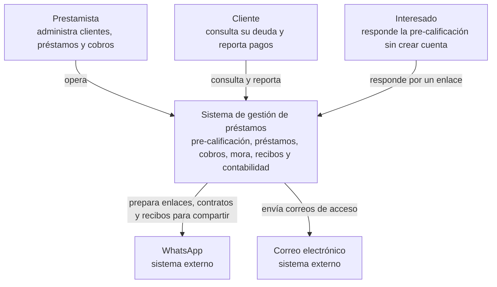
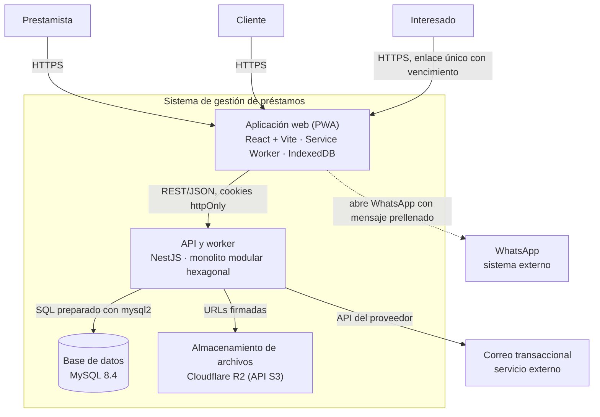

# Arquitectura del sistema

Documento de arquitectura del sistema de gestión de préstamos para prestamistas independientes. Usa el modelo C4 (niveles 1 y 2) escrito en Mermaid, de modo que los diagramas viajan con el código y se revisan en cada PR.

Este documento resume la arquitectura definida en el documento maestro del proyecto (§10). Las decisiones difíciles de cambiar se registran como ADR en [docs/adr](../adr/).

## Estado de implementación

La arquitectura de abajo es el **diseño objetivo**. Hoy solo existe una parte; el resto está planificado y se construye por fases. Se deja explícito para que el diagrama no se lea como algo ya construido.

| Pieza | Tecnología | Estado |
|---|---|---|
| Motor financiero (`packages/domain`) | TypeScript puro | En construcción: dinero, plan de cuotas con interés fijo y mora, con 62 pruebas |
| API y worker | NestJS | Planificado (Fase 1) |
| Base de datos | MySQL 8.4 con SQL escrito a mano | Planificado (Fase 1); existe un borrador del esquema |
| Aplicación web (PWA) | React + Vite | Planificado (Fase 3) |
| Almacenamiento de archivos | Cloudflare R2 | Planificado (Fase 3) |

## Nivel 1: Contexto

Muestra el sistema como una sola caja, quién lo usa y con qué sistemas externos se relaciona. No lleva tecnologías.

En la primera versión el prestamista comparte los mensajes y documentos por WhatsApp de forma manual (el sistema deja el mensaje prellenado). Los avisos automáticos por WhatsApp quedan para una versión posterior.

## Nivel 2: Contenedores

Abre la caja del sistema: las piezas que se ejecutan por separado y con qué tecnología.

`packages/domain` no aparece como contenedor porque es una librería del monorepo, no un proceso: la API la usa para todas las reglas financieras y no depende de ninguna otra pieza.

### Qué se acepta perder en cada conexión

Detrás de cada conexión hay una decisión y su costo.

| Conexión | Qué se gana | Qué se paga |
|---|---|---|
| Web y API separadas, hablando REST/JSON | Una API sin estado que se puede replicar; el frontend funciona offline con su propia cola | Dos aplicaciones que desplegar y un contrato (esquemas Zod compartidos) que mantener |
| API a MySQL con SQL escrito a mano, sin ORM | Control total del SQL, triggers e índices; cumple la restricción del curso | Más código repetitivo y más riesgo de errores de SQL, que se mitigan con pruebas de integración |
| Un solo monolito modular en vez de microservicios | Límites claros con un solo despliegue y una sola base transaccional | Los módulos comparten proceso y base; separarlos después exige disciplina en las fronteras |
| Archivos fuera de la base de datos | La base se mantiene pequeña y los respaldos son más rápidos | Un servicio más del cual depender y URLs firmadas que gestionar |

## Regla de dependencia

Las dependencias apuntan hacia adentro: la interfaz y la infraestructura dependen de la aplicación y del dominio, nunca al revés. El dominio no importa frameworks, base de datos ni HTTP. Hoy esa regla se cumple en `packages/domain`; se comprobará automáticamente con `dependency-cruiser` en la integración continua.

## Decisiones registradas

| ADR | Decisión | Estado |
|---|---|---|
| [0003](../adr/0003-dinero-en-centavos-y-puntos-base.md) | Dinero en centavos enteros y tasas en puntos base | Aceptada e implementada en `packages/domain` |
| [0006](../adr/0006-pagos-inmutables-con-reversos.md) | Pagos, asientos y auditoría inmutables, corregidos con reversos | Aceptada, pendiente de implementar |

## Niveles que no se dibujan

El nivel 3 (componentes) se dibujará solo cuando un contenedor, probablemente la API, crezca lo suficiente para que alguien nuevo se pierda dentro. El nivel 4 (código) no se dibuja: el código ya es ese nivel.
