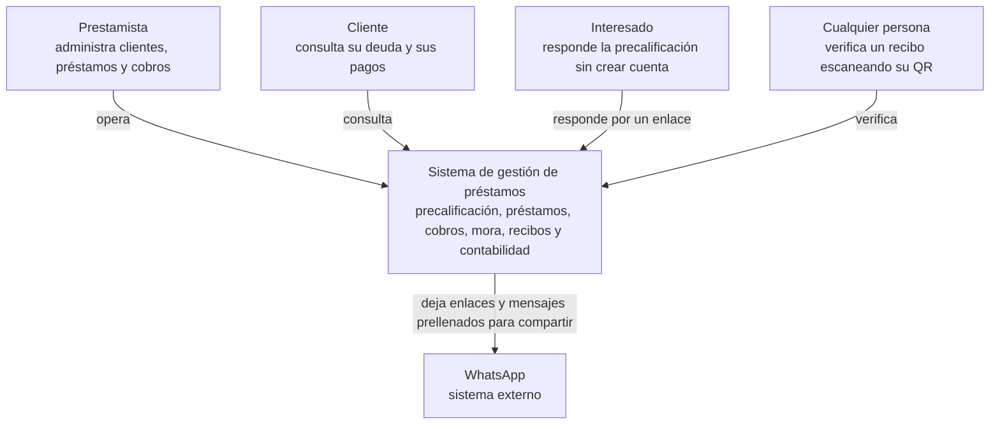
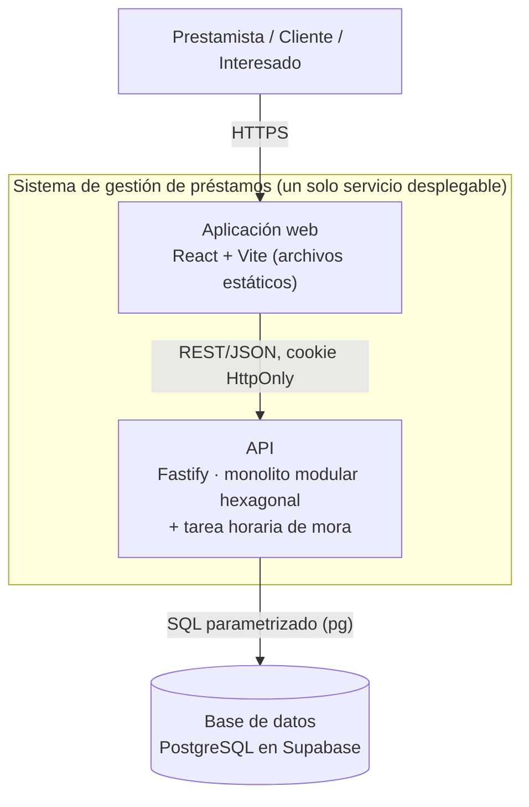
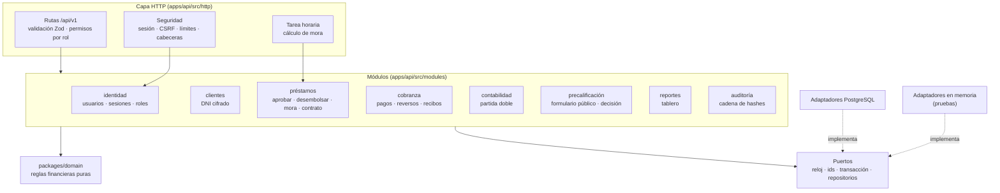

# Arquitectura del sistema

Documento de arquitectura del sistema de gestión de préstamos para prestamistas independientes. Usa el modelo C4 (niveles 1, 2 y 3) escrito en Mermaid, de modo que los diagramas viajan con el código y se revisan en cada PR.

Las decisiones difíciles de cambiar se registran como ADR en [docs/adr](../adr/).

## Estado de implementación

| Pieza | Tecnología | Estado |
|---|---|---|
| Motor financiero (`packages/domain`) | TypeScript puro | Hecho: dinero, cuotas (3 métodos de interés), mora, reparto de pagos, partida doble, tasa efectiva anual y precalificación. 209 pruebas, 98 % de cobertura |
| API (`apps/api`) | Fastify 5, arquitectura hexagonal ([ADR 0010](../adr/0010-api-fastify-y-sesiones-con-cookie.md)) | Hecho. Casos de uso probados con adaptadores en memoria y contra PostgreSQL real |
| Contratos (`packages/contracts`) | Zod | Hecho: esquemas de entrada y tipos de respuesta compartidos con la web |
| Base de datos | PostgreSQL (Supabase) con SQL a mano, sin ORM | Hecho: 9 migraciones versionadas |
| Aplicación web (`apps/web`) | React + Vite | Hecho. El modo sin conexión (PWA) es la siguiente fase |
| Documentos | pdfkit y qrcode, generados al vuelo | Hecho: recibo con QR, contrato y pagaré. No se guardan archivos: se regeneran desde los datos |
| Almacenamiento de archivos (R2) | — | No hace falta todavía; se agregará con la subida de comprobantes del cliente |

## Nivel 1: Contexto

Muestra el sistema como una sola caja, quién lo usa y con qué sistemas externos se relaciona. No lleva tecnologías.

El prestamista comparte mensajes y documentos por WhatsApp de forma manual (el sistema deja el mensaje escrito). Los avisos automáticos por WhatsApp quedan para una versión posterior.

## Nivel 2: Contenedores

Abre la caja del sistema: las piezas que se ejecutan por separado y con qué tecnología.

La API sirve también la aplicación web compilada: una sola dirección, una sola cookie y sin CORS. `packages/domain` y `packages/contracts` no aparecen como contenedores porque son librerías del monorepo, no procesos.

### Qué se acepta perder en cada conexión

| Conexión | Qué se gana | Qué se paga |
|---|---|---|
| Web y API en un solo servicio | Un despliegue, una URL y una cookie; sin CORS | Escalar la web y la API por separado exigiría separarlos (es posible: la web es estática) |
| API a PostgreSQL con SQL escrito a mano, sin ORM | Control total del SQL, triggers, seguridad por fila e índices; cumple la restricción del curso | Más código repetitivo y más riesgo de errores de SQL, que se mitigan con pruebas de integración contra PostgreSQL real |
| Un solo monolito modular en vez de microservicios | Límites claros con un solo despliegue y una sola base transaccional | Los módulos comparten proceso y base; separarlos después exige disciplina (hoy la hace cumplir una prueba automática) |
| Sesiones en el servidor en vez de JWT | Cerrar sesión o desactivar a alguien corta el acceso al instante | Dos consultas por solicitud autenticada (ver ADR 0010) |

## Nivel 3: Componentes de la API

La API ya es lo bastante grande como para dibujarla por dentro. Cada módulo tiene sus capas `domain`, `application` e `infrastructure`.

El cableado de los adaptadores reales vive en un solo archivo (`http/compose-postgres.ts`); las pruebas rápidas arman el mismo sistema con memoria (`testing/memory-services.ts`).

## Regla de dependencia

Las dependencias apuntan hacia adentro: la interfaz y la infraestructura dependen de la aplicación y del dominio, nunca al revés. **Esta regla se comprueba automáticamente** en `apps/api/src/architecture.test.ts` y falla si:

- el dominio o un caso de uso importa `infrastructure`, `pg`, `fastify`, `pdfkit` o `qrcode`;
- algún módulo o caso de uso conoce la capa HTTP;
- un módulo usa la infraestructura de otro módulo;
- el código de producción importa carpetas de pruebas;
- `packages/domain` importa algo que no sea de su propio paquete, o usa la hora o el azar del sistema;
- una consulta SQL se arma concatenando valores en lugar de usar parámetros.

La primera vez que se corrió, la prueba encontró dos violaciones reales (casos de uso de identidad que importaban un archivo de infraestructura y un PDF que importaba código de otro módulo); se corrigieron.

## Aislamiento entre organizaciones (multi-tenant)

Cada fila pertenece a una organización y toda consulta recibe la organización de quien hace la solicitud. La protección tiene tres niveles:

1. **Aplicación:** los repositorios filtran siempre por organización; un recurso de otra organización "no existe" (404, no 403).
2. **Base de datos:** llaves foráneas compuestas (`organization_id, id`) impiden que un préstamo o una cuenta de cliente apunte a un cliente de otra organización (migración 0009).
3. **Pruebas:** un conjunto de pruebas de acceso indebido intenta leer, modificar, descargar y revertir recursos ajenos, y comprueba que nada cambia.

## Decisiones registradas

| ADR | Decisión | Estado |
|---|---|---|
| [0003](../adr/0003-dinero-en-centavos-y-puntos-base.md) | Dinero en centavos enteros y tasas en puntos base | Aceptada e implementada |
| [0006](../adr/0006-pagos-inmutables-con-reversos.md) | Pagos, asientos y auditoría inmutables, corregidos con reversos | Aceptada e implementada (migración 0004; el motor es PostgreSQL, ver la actualización en el ADR) |
| [0010](../adr/0010-api-fastify-y-sesiones-con-cookie.md) | API con Fastify y sesiones en cookie HttpOnly | Aceptada e implementada |

## Nivel que no se dibuja

El nivel 4 (código) no se dibuja: el código ya es ese nivel.
